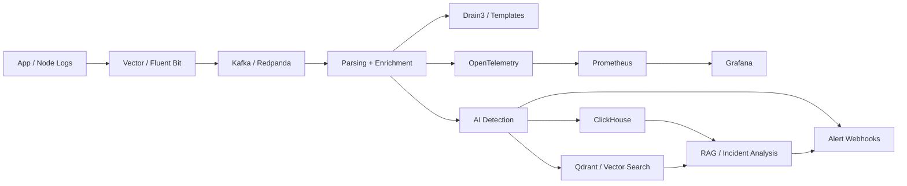

# LogSight-AI — Enterprise Log Monitoring & Anomaly Detection

<!-- portfolio-lifecycle-badges:start -->
[](https://github.com/CoreyLeath-code/LogSight-AI/releases/latest)
[](#ownership-promotion-and-operational-lifecycle)
[](https://github.com/CoreyLeath-code)
<!-- portfolio-lifecycle-badges:end -->

[](https://github.com/CoreyLeath-code/LogSight-AI/actions/workflows/ci.yml)
[](https://github.com/CoreyLeath-code/LogSight-AI/actions/workflows/codeql.yml)
[](https://github.com/CoreyLeath-code/LogSight-AI/releases/latest)
[](https://www.python.org/)
[](LICENSE)
[](https://www.docker.com/)
[](https://fastapi.tiangolo.com/)

Overview

LogSight-AI is a local-first log analysis and anomaly-detection platform that is being extended from a deterministic CLI into a production-oriented observability stack. The original parser/analyzer remains dependency-light and explainable; enterprise integrations are optional and isolated behind adapters.

## Enterprise architecture



### Five production layers

1. **Ingestion & streaming** — bounded async streams plus an optional Kafka/Redpanda adapter. Deploy Vector or Fluent Bit at the edge for collection and metadata enrichment.
2. **AI & anomaly detection** — deterministic template/frequency signals are available now. The adapter boundary supports Drain3, Sentence-Transformers/LogBERT, ONNX Runtime, and future learned detectors without replacing the core API.
3. **Storage & search** — ClickHouse event storage and Qdrant vector storage adapters are included; Redis is reserved for caching, deduplication, and rate limiting.
4. **Observability & MLOps** — OpenTelemetry span helpers and Prometheus-compatible `/metrics` are included. Model/data-drift tooling can be attached to the normalized event stream.
5. **Delivery & alerting** — `WebhookNotifier` provides a minimal outbound contract for Slack, PagerDuty, Discord, or an internal incident gateway.

## New enterprise interfaces

- `logsight.enterprise.EnrichedLog` — normalized event schema with service/source/host, trace ID, span ID, template, fingerprint, and attributes.
- `logsight.enterprise.extract_template()` — dependency-free template baseline.
- `logsight.templates.Drain3TemplateParser` — optional stateful Drain3 adapter selected through `LOGSIGHT_TEMPLATE_PARSER=drain3`.
- `logsight.enterprise.semantic_features()` — deterministic feature baseline; explicitly **not** represented as a learned embedding.
- `logsight.embeddings.EmbeddingWorker` — bounded off-path Sentence-Transformers batch worker with model provenance and output validation.
- `logsight.logbert.LogBertAnomalyAdapter` — bounded local-checkpoint masked-LM adapter with calibrated loss-threshold decisions.
- `logsight.onnx_worker.OnnxInferenceWorker` — bounded ONNX Runtime feature-batch worker with model provenance and score validation.
- `logsight.redis_control.RedisAdmissionController` — atomic Redis deduplication and per-service rate-limit admission control.
- `logsight.streaming.InMemoryStream` — bounded local async stream for tests and development.
- `logsight.streaming.KafkaStream` — optional Kafka/Redpanda producer using `aiokafka`.
- `logsight.storage.ClickHouseStore` and `QdrantStore` — HTTP adapters for durable analytical and semantic storage.
- `logsight.api` — optional FastAPI gateway with `/health`, `/metrics`, `/v1/logs`, `/v1/logs/batch`, and `/v1/logs/recent`.
- `logsight.observability.span()` — no-op-safe OpenTelemetry instrumentation helper.

## Enterprise local stack

The base project still runs without external services. To launch the reference enterprise stack:

```bash
docker compose -f docker-compose.enterprise.yml up --build
```

Services exposed locally:

| Service | Port | Purpose |
|---|---:|---|
| LogSight API | 8000 | Async ingestion/API gateway |
| Redpanda | 9092 | Streaming buffer |
| ClickHouse | 8123 | Log analytics/storage |
| Qdrant | 6333 | Vector similarity search |
| Redis | 6379 | Cache/dedup/rate limiting foundation |
| Prometheus | 9090 | Metrics collection |
| Grafana | 3000 | Dashboards |

Install optional Python integrations with:

```bash
pip install -e ".[api,kafka,observability,ai,parsing,redis]"
```

The optional integrations are deliberately separated so a developer can use the original local-first CLI without downloading heavyweight ML or infrastructure clients.

### Redis admission controls

Redis admission controls are disabled unless `LOGSIGHT_REDIS_URL` is configured. Once
enabled, one atomic Lua script rejects duplicate fingerprints before consuming a per-service
rate-limit token. The scope is hashed before it becomes a Redis key, and rejected events do
not enter the in-memory analysis window:

```bash
export LOGSIGHT_REDIS_URL=redis://localhost:6379/0
export LOGSIGHT_RATE_LIMIT=120
export LOGSIGHT_RATE_WINDOW_SECONDS=60
export LOGSIGHT_DEDUP_TTL_SECONDS=300
```

The API returns `409` for a duplicate and `429` for an exhausted rate budget. Redis
availability is therefore a deployment requirement when this control is enabled; use a
durable, highly available Redis deployment and monitor connection failures. Batch ingestion
is processed in order and is not transactional: accepted entries remain accepted if a later
entry is rejected.

### Embedding worker

The optional Sentence-Transformers worker batches normalized log messages outside the
ingestion request path. It validates batch size, message size, vector count, finite values,
and dimensional consistency before results can be stored or indexed. Configure the model
and upper batch bound explicitly:

```bash
export LOGSIGHT_EMBEDDING_MODEL=sentence-transformers/all-MiniLM-L6-v2
export LOGSIGHT_EMBEDDING_BATCH_SIZE=64
```

Model artifacts must be provisioned through the deployment's approved artifact path.
The worker does not download models during an ingestion request, perform distributed
scheduling, or claim that a Sentence-Transformers model is a LogBERT anomaly detector.

### LogBERT anomaly adapter

The optional adapter accepts a local Hugging Face masked-LM checkpoint that is compatible
with the LogBERT scoring contract. It uses per-template masked-LM loss and a deployment-
calibrated threshold; the score is not a probability or an incident decision on its own:

```bash
export LOGSIGHT_LOGBERT_MODEL_PATH=/models/logbert
export LOGSIGHT_LOGBERT_LOSS_THRESHOLD=2.4
export LOGSIGHT_LOGBERT_BATCH_SIZE=64
```

The model directory must be provisioned before startup. The adapter uses local files only
and does not download a checkpoint during processing. Threshold calibration, false-positive
analysis, and alert policy remain deployment responsibilities.

### ONNX inference worker

The optional ONNX worker accepts only aligned, finite feature batches matching a
deployment-declared input dimension. It validates output count and shape before returning
model scores, but it deliberately does not decide model thresholds or alert policy:

```bash
export LOGSIGHT_ONNX_MODEL_PATH=/models/log-anomaly-detector.onnx
export LOGSIGHT_ONNX_INPUT_DIMENSION=32
export LOGSIGHT_ONNX_BATCH_SIZE=64
```

Use immutable model artifacts and record the model digest with each deployment. The worker
uses CPU ONNX Runtime by default; accelerator/provider selection and distributed inference
remain explicit follow-on deployment work.

### Drain3 template parsing

The default `baseline` parser remains deterministic and dependency-free. Enable Drain3 only
after installing the `parsing` extra and providing a deployment-owned configuration file:

```bash
export LOGSIGHT_TEMPLATE_PARSER=drain3
export LOGSIGHT_DRAIN3_CONFIG=/etc/logsight/drain3.ini
```

Drain3 learns templates in memory and is serialized within each API worker. A multi-worker
deployment must define how its parser state is persisted and coordinated; this adapter does
not claim cross-worker template consistency on its own.

## Current detection contract

The original analyzer uses explainable statistical heuristics: message-length z-score outliers, direct ERROR/CRITICAL rules, and elevated error-rate windows. These are not presented as calibrated incident probabilities. The enterprise layer preserves that evidence-first behavior while adding normalized event context and pluggable AI interfaces.

## Quick start

```bash
python -m venv .venv
source .venv/bin/activate  # Windows: .venv\\Scripts\\activate
pip install -e .
logsight health
logsight analyze application.log --explain
```

## Engineering controls

Pull requests retain the existing formatting, linting, strict typing, unit/integration/CLI tests, coverage gate, package/container validation, Bandit, dependency audit, SBOM, CodeQL, and reproducible benchmark controls. Enterprise changes should include contract tests for adapters and load tests before production rollout.

## Roadmap

- [x] Normalized enterprise event contract
- [x] Kafka/Redpanda ingestion adapter
- [x] ClickHouse/Qdrant storage adapters
- [x] FastAPI async gateway
- [x] Prometheus endpoint and OpenTelemetry helper
- [x] Enterprise Docker Compose reference stack
- [x] Drain3 production parser adapter
- [x] Sentence-Transformers embedding worker
- [x] LogBERT anomaly-model adapter
- [x] ONNX Runtime inference worker
- [x] Redis-backed deduplication/rate limiting
- [ ] OTel Collector deployment and trace-log correlation pipeline
- [ ] Celery/Ray distributed inference workers
- [ ] Helm chart with HPA/PDB/network policies
- [ ] RAG incident investigator with versioned runbooks/commits
- [ ] Labeled benchmark corpus with precision/recall and alert-burden metrics

## Documentation

- [Production audit](docs/AUDIT.md)
- [Architecture](docs/architecture.md)
- [Deployment and rollback checklist](docs/DEPLOYMENT.md)
- [Benchmark methodology](docs/BENCHMARKING.md)
- [Mathematical foundations](docs/MATHEMATICAL_FOUNDATIONS.md)
- [Security policy](SECURITY.md)

## License

MIT


---

## Ownership, promotion, and operational lifecycle

**Accountable owner:** [Corey Leath](https://github.com/CoreyLeath-code) maintains this portfolio repository. Contributions and operational changes should be traceable through GitHub issues, pull requests, review, and a versioned release record.

**Evidence boundary:** this repository documents a reproducible engineering project. It must not be interpreted as a claim of a continuously operated production service, live customer deployment, or managed staging environment unless that evidence is explicitly linked here.

| Lifecycle stage | Ownership and control | Promotion evidence |
|---|---|---|
| **Develop** | The change owner works in an isolated branch or local environment, uses example configuration rather than secrets, and updates tests and documentation with the code. | Local validation plus the repository's automated checks where configured. |
| **Stage** | The maintainer validates the deployable artifact and environment-specific configuration before a production promotion. | No always-on hosted staging environment is asserted by this README; staging must use non-production credentials/data and record validation results. |
| **Produce** | The maintainer approves a versioned release only after required checks, security review, and rollback expectations have been evaluated. | A Git tag, release notes, immutable artifact or image digest where applicable, and a documented rollback target. |
| **Monitor** | The maintainer owns service health, error, latency, data/model-quality, and security signals appropriate to the project. | Logs, metrics, dashboards, alerts, and an incident record where an operational deployment exists. |

### Operating expectations

- Treat configuration, credentials, datasets, model artifacts, and infrastructure state as environment-specific; do not commit secrets or production data.
- Block promotion when automated validation, dependency/security checks, or release evidence is incomplete.
- Record material incidents, remediation, and follow-up work in GitHub so ownership survives handoffs.
- Reassess this lifecycle when the project gains a real hosted environment, service-level objective, on-call rotation, or regulated-use case.

*Lifecycle statement added during the portfolio L6 audit on 2026-11-11.*
