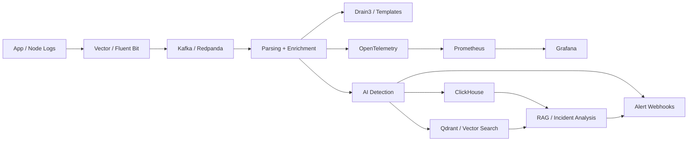

# LogSight-AI — Enterprise Log Monitoring & Anomaly Detection

<!-- portfolio-lifecycle-badges:start -->
[](https://github.com/CoreyLeath-code/LogSight-AI/releases/latest)
[](#ownership-promotion-and-operational-lifecycle)
[](https://github.com/CoreyLeath-code)
<!-- portfolio-lifecycle-badges:end -->

[](https://github.com/CoreyLeath-code/LogSight-AI/actions/workflows/ci.yml)
[](https://github.com/CoreyLeath-code/LogSight-AI/actions/workflows/codeql.yml)
[](https://www.python.org/)
[](LICENSE)
[](https://www.docker.com/)
[](https://fastapi.tiangolo.com/)

Overview

LogSight-AI is a local-first log analysis and anomaly-detection platform that is being extended from a deterministic CLI into a production-oriented observability stack. The original parser/analyzer remains dependency-light and explainable; enterprise integrations are optional and isolated behind adapters.

### ClickHouse sink failure signals (Phase 4 incremental)

The experimental Kafka-to-ClickHouse worker emits two fixed, low-cardinality
ERROR log messages (without event bodies, topic names, credentials, exception
strings or record identities):

- `clickhouse_insert_failed offset_uncommitted`: ClickHouse insert failed or
  returned an ambiguous outcome; no source offset commit is attempted.
- `kafka_offset_commit_failed insert_outcome_success_replay_possible`: the
  storage insert returned successfully but the source offset commit failed.
  On replay, the same event may be delivered again, subject to the bounded
  ClickHouse deduplication window.

These signals can be searched in an operator-controlled logging backend.
They do **not** establish continuous health, an alert policy, exactly-once
delivery, bounded retry, or live outage recovery. Log forwarding, alerts and
a reviewed failure-injection drill remain outstanding.

### Experimental Kafka-to-ClickHouse sink

The repository includes a single-worker reference sink launched with
`python -m logsight.kafka_clickhouse_worker` after installing `.[kafka]`.
Configure `KAFKA_BOOTSTRAP_SERVERS`, `LOGSIGHT_KAFKA_TOPIC`,
`LOGSIGHT_KAFKA_CONSUMER_GROUP`, and `CLICKHOUSE_URL`, and create the
ClickHouse schema using [deploy/clickhouse/init.sql](deploy/clickhouse/init.sql).

The sink validates and re-redacts consumed events, maps them to the ClickHouse
JSONEachRow table schema, and commits a Kafka consumer offset only after
ClickHouse insert returns successfully. On invalid records or storage
failure it stops rather than silently skipping an event.

**Not yet production-ready:** failed offset commits and repeated deliveries can
create duplicate ClickHouse rows, because no durable event-ID deduplication
policy exists. A malformed record can block a partition; dead-letter
handling, authentication/TLS, migrations, consumer rebalances, retry budgets,
retention, and broker/storage outage drills remain open. No live-broker
integration result is asserted.

### Experimental broker-acknowledged API ingestion

Set `LOGSIGHT_API_KAFKA_ENABLED=true`, `KAFKA_BOOTSTRAP_SERVERS`, and
`LOGSIGHT_KAFKA_TOPIC` to opt into broker-acknowledged ingestion. The API
starts/stops the Kafka producer with its application lifespan and returns
HTTP 503 if an acknowledgement cannot be confirmed. This mode requires
the optional `kafka` dependency and must not be combined with the current
Redis admission controller, whose dedup keys are committed before broker
acknowledgements. For an experimental isolated deployment, omit
`LOGSIGHT_REDIS_URL` and install `.[api,kafka]`.

**Delivery caveats:** HTTP 503 does not prove broker rejection. Retrying may
duplicate events. Batch submissions are not atomic: earlier events may have
been acknowledged before a later event fails. The process-local recent-event
cache is not durable, and no ClickHouse consumer or cross-tenant isolation is
implemented. This mode is for controlled evaluation, not production.

### Bounded API ingestion bodies (incremental)

The API now limits request bodies for `POST /v1/logs` and
`POST /v1/logs/batch` using `LOGSIGHT_API_MAX_BODY_BYTES` (default:
1,048,576 bytes; configurable up to 16 MiB). Oversized requests return HTTP
413 before parsing or scoring. The limit covers requests with and without a
`Content-Length` header. It does **not** replace ingress-level request limits,
per-tenant admission controls, concurrency limits, or timeouts.

### API access hardening (incremental)

The optional FastAPI gateway supports `LOGSIGHT_API_AUTH_MODE=token` with a
secret stored in `LOGSIGHT_API_TOKEN` (minimum 32 characters). Protected
requests supply `Authorization: Bearer <token>`; `/health` remains public.
The default `disabled` mode is for local development only. This shared-key
control is **not** tenant-scoped authorization, a managed workload identity,
or proof of production readiness. See the
[production-readiness roadmap](docs/PRODUCTION_READINESS_ROADMAP.md) for open
security, privacy, and durable-ingestion gates.

### Production status

LogSight-AI is a production-oriented engineering foundation; it is **not yet approved for an internet-facing, multi-tenant, or consequential production deployment**. The completed roadmap below establishes interfaces and controls. The remaining work is governed by the [production-readiness roadmap](docs/PRODUCTION_READINESS_ROADMAP.md), whose exit evidence—not checkbox completion alone—defines promotion.

## Reviewer map

| Start here | Evidence to inspect |
|---|---|
| [CLI and tests](#quick-start) | Local setup and executable verification commands |
| [Supported detection behavior](#current-detection-contract) | Explainable analysis and explicit algorithm boundaries |
| [Architecture](#enterprise-architecture) | Adapters versus the core local-first path |
| [Promotion blockers](docs/PRODUCTION_READINESS_ROADMAP.md) | Outstanding evidence required for production readiness |
| [CI workflows](.github/workflows/) | Automated checks and release configuration |

**Scope:** an integration shown in the architecture is not proof of a continuously deployed or load-tested external service. Follow the linked tests and runbooks to determine which adapters are exercised.

## Enterprise architecture



### Five production layers

1. **Ingestion & streaming** — bounded async streams plus an optional Kafka/Redpanda adapter. Deploy Vector or Fluent Bit at the edge for collection and metadata enrichment.
2. **AI & anomaly detection** — deterministic template/frequency signals are available now. The adapter boundary supports Drain3, Sentence-Transformers/LogBERT, ONNX Runtime, and future learned detectors without replacing the core API.
3. **Storage & search** — ClickHouse event storage and Qdrant vector storage adapters are included; Redis is reserved for caching, deduplication, and rate limiting.
4. **Observability & MLOps** — OpenTelemetry span helpers and Prometheus-compatible `/metrics` are included. Model/data-drift tooling can be attached to the normalized event stream.
5. **Delivery & alerting** — `WebhookNotifier` provides a minimal outbound contract for Slack, PagerDuty, Discord, or an internal incident gateway.

## New enterprise interfaces

- `logsight.enterprise.EnrichedLog` — normalized event schema with service/source/host, trace ID, span ID, template, fingerprint, and attributes.
- `logsight.enterprise.extract_template()` — dependency-free template baseline.
- `logsight.templates.Drain3TemplateParser` — optional stateful Drain3 adapter selected through `LOGSIGHT_TEMPLATE_PARSER=drain3`.
- `logsight.enterprise.semantic_features()` — deterministic feature baseline; explicitly **not** represented as a learned embedding.
- `logsight.embeddings.EmbeddingWorker` — bounded off-path Sentence-Transformers batch worker with model provenance and output validation.
- `logsight.logbert.LogBertAnomalyAdapter` — bounded local-checkpoint masked-LM adapter with calibrated loss-threshold decisions.
- `logsight.onnx_worker.OnnxInferenceWorker` — bounded ONNX Runtime feature-batch worker with model provenance and score validation.
- `logsight.redis_control.RedisAdmissionController` — atomic Redis deduplication and per-service rate-limit admission control.
- `logsight.distributed.CeleryInferenceDispatcher` — bounded JSON Celery dispatch for asynchronous embedding work.
- `logsight.investigator.IncidentInvestigator` — retrieval-grounded, version-pinned incident runbook investigator with evidence citations.
- `logsight.benchmarking` — versioned labeled-corpus evaluator for precision, recall, incident coverage, and alert burden.
- `logsight.streaming.InMemoryStream` — bounded local async stream for tests and development.
- `logsight.streaming.KafkaStream` — optional Kafka/Redpanda producer using `aiokafka`.
- `logsight.storage.ClickHouseStore` and `QdrantStore` — HTTP adapters for durable analytical and semantic storage.
- `logsight.api` — optional FastAPI gateway with `/health`, `/metrics`, `/v1/logs`, `/v1/logs/batch`, and `/v1/logs/recent`.
- `logsight.observability.span()` — no-op-safe OpenTelemetry instrumentation helper.
- `logsight.observability.correlate_with_active_span()` — attaches active trace/span IDs to normalized events without overwriting supplied correlation fields.

## Enterprise local stack

The base project still runs without external services. To launch the reference enterprise stack:

```bash
docker compose -f docker-compose.enterprise.yml up --build
```

Services exposed locally:

| Service | Port | Purpose |
|---|---:|---|
| LogSight API | 8000 | Async ingestion/API gateway |
| Redpanda | 9092 | Streaming buffer |
| ClickHouse | 8123 | Log analytics/storage |
| Qdrant | 6333 | Vector similarity search |
| Redis | 6379 | Cache/dedup/rate limiting foundation |
| Celery worker | — | Bounded asynchronous embedding inference |
| OTel Collector | 4317 / 4318 | OTLP trace and log intake |
| Prometheus | 9090 | Metrics collection |
| Grafana | 3000 | Dashboards |

Install optional Python integrations with:

```bash
pip install -e ".[api,kafka,observability,ai,parsing,redis]"
```

The optional integrations are deliberately separated so a developer can use the original local-first CLI without downloading heavyweight ML or infrastructure clients.

### Labeled benchmark corpus

The synthetic, versioned benchmark corpus provides a reproducible regression signal for
precision, recall, incident coverage, and alert burden. Run it directly or apply
deployment-owned quality gates:

```bash
logsight benchmark
logsight benchmark --min-precision 0.95 --min-recall 0.90 \
  --max-alerts-per-1000-events 250
```

The gate values are not universal production claims: choose them from a reviewed,
representative corpus and promotion policy. See [labeled benchmark controls](docs/LABELED_BENCHMARKS.md).

### Incident investigator

The incident investigator retrieves only approved local Markdown runbooks and returns
deterministically ranked excerpts with the runbook version, supplied immutable repository
revision, source path, and a SHA-256 content digest. It does not call a hosted model,
diagnose a root cause, take remediation actions, or turn an excerpt into an authorization
to act.

```bash
logsight investigate "database timeout during checkout" \
  --runbooks ./runbooks \
  --revision "$(git rev-parse HEAD)" \
  --evidence "ERROR connection pool timeout"
```

See [incident-investigator controls](docs/INCIDENT_INVESTIGATOR.md) for the runbook
format, provenance contract, and production-promotion expectations.

### Helm deployment

The production chart at `charts/logsight-ai` deploys the API with an HPA, PDB,
hardened pod/container settings, and a default-deny NetworkPolicy. It requires an
immutable image reference and explicit egress rules for deployment-owned
dependencies. See the [Helm chart guide](charts/logsight-ai/README.md).

### Distributed inference workers

The enterprise Compose stack includes an idle Celery embedding worker. Its task
contract accepts bounded JSON envelopes only, limits prefetching to one task, and
uses late acknowledgement/reject-on-worker-loss semantics. API dispatch is
disabled until a deployment provisions an approved model artifact:

```bash
export LOGSIGHT_CELERY_DISPATCH_ENABLED=true
export LOGSIGHT_EMBEDDING_MODEL=/models/approved-embedding-model
```

After enabling it, accepted API events include an `inference_task_id`; asynchronous
embedding does not change the request-time anomaly score. See
[Celery worker deployment](docs/CELERY_WORKERS.md) for queue, security, and
production-promotion controls.

### OpenTelemetry Collector and trace–log correlation

The enterprise reference stack includes an OTLP Collector. Set
`LOGSIGHT_OTEL_ENABLED=true` and `OTEL_EXPORTER_OTLP_ENDPOINT` to export ingestion
spans. The API preserves trace/span IDs found in log content and supplies missing
IDs from its active ingestion span, making each normalized event joinable to its
trace. The supplied Collector configuration uses a debug exporter for local
validation only; configure authenticated production backends before promotion.

See [Collector deployment and correlation](docs/OTEL_COLLECTOR.md) for validation
and production-promotion guidance.

### Low-cardinality readiness counters (Phase 4 incremental)

The existing authenticated `/metrics` endpoint includes cumulative counters
for successful readiness checks and failures attributed to Kafka or Redis:
`logsight_readiness_success_total`,
`logsight_readiness_kafka_failure_total`, and
`logsight_readiness_redis_failure_total`. They contain no tenant, host, topic
or error-message labels; their scope is the local API process and resets on
restart. A Kafka failure takes precedence if both dependency checks are unhealthy.
The counters reflect **readiness requests**, not outages, failed events or
successful durable log deliveries. Production monitoring still requires
deployment-level aggregation, SLO-owned alerts and a staging alert drill.

### Inference enqueue failure semantics (Phase 4 incremental)

When optional Celery inference dispatch is enabled, a failed enqueue now returns
a sanitized HTTP 503 instead of leaking the underlying broker exception. The
response explicitly warns that retrying can duplicate a previously accepted
Kafka event or accepted Celery task. Existing Kafka and process-local ingestion
effects **are not rolled back** after a failed or ambiguous enqueue; this is a
failure-reporting hardening step, not an atomic Kafka-to-Celery transaction.
It does not monitor inference worker availability, task execution, or result
durability. Verify worker outages and replay behavior in staging.

### Bounded Redis admission readiness (Phase 4 incremental)

When `LOGSIGHT_REDIS_URL` enables Redis admission control, `GET /ready`
also performs a bounded asynchronous Redis `PING`. Set
`LOGSIGHT_REDIS_READINESS_TIMEOUT_SECONDS` to a value greater than 0 and at
most 5 seconds (default: 1). A timeout, connection failure, unsupported client
or unsuccessful response returns HTTP 503 without leaking dependency details;
`GET /health` remains independent. No Redis probe runs when admission is disabled.

**Limit:** A PING does not prove the admission Lua script, quotas, persistence,
HA failover or durability work correctly. Frequent Kubernetes readiness
requests generate additional Redis traffic. Redis readiness is currently
evaluated on request; capacity and failure-injection evidence are still needed.

### Redis admission controls

Redis admission controls are disabled unless `LOGSIGHT_REDIS_URL` is configured. Once
enabled, one atomic Lua script rejects duplicate fingerprints before consuming a per-service
rate-limit token. The scope is hashed before it becomes a Redis key, and rejected events do
not enter the in-memory analysis window:

```bash
export LOGSIGHT_REDIS_URL=redis://localhost:6379/0
export LOGSIGHT_RATE_LIMIT=120
export LOGSIGHT_RATE_WINDOW_SECONDS=60
export LOGSIGHT_DEDUP_TTL_SECONDS=300
```

The API returns `409` for a duplicate and `429` for an exhausted rate budget. Redis
availability is therefore a deployment requirement when this control is enabled; use a
durable, highly available Redis deployment and monitor connection failures. Batch ingestion
is processed in order and is not transactional: accepted entries remain accepted if a later
entry is rejected.

### Embedding worker

The optional Sentence-Transformers worker batches normalized log messages outside the
ingestion request path. It validates batch size, message size, vector count, finite values,
and dimensional consistency before results can be stored or indexed. Configure the model
and upper batch bound explicitly:

```bash
export LOGSIGHT_EMBEDDING_MODEL=sentence-transformers/all-MiniLM-L6-v2
export LOGSIGHT_EMBEDDING_BATCH_SIZE=64
```

Model artifacts must be provisioned through the deployment's approved artifact path.
The worker does not download models during an ingestion request, perform distributed
scheduling, or claim that a Sentence-Transformers model is a LogBERT anomaly detector.

### LogBERT anomaly adapter

The optional adapter accepts a local Hugging Face masked-LM checkpoint that is compatible
with the LogBERT scoring contract. It uses per-template masked-LM loss and a deployment-
calibrated threshold; the score is not a probability or an incident decision on its own:

```bash
export LOGSIGHT_LOGBERT_MODEL_PATH=/models/logbert
export LOGSIGHT_LOGBERT_LOSS_THRESHOLD=2.4
export LOGSIGHT_LOGBERT_BATCH_SIZE=64
```

The model directory must be provisioned before startup. The adapter uses local files only
and does not download a checkpoint during processing. Threshold calibration, false-positive
analysis, and alert policy remain deployment responsibilities.

### ONNX inference worker

The optional ONNX worker accepts only aligned, finite feature batches matching a
deployment-declared input dimension. It validates output count and shape before returning
model scores, but it deliberately does not decide model thresholds or alert policy:

```bash
export LOGSIGHT_ONNX_MODEL_PATH=/models/log-anomaly-detector.onnx
export LOGSIGHT_ONNX_INPUT_DIMENSION=32
export LOGSIGHT_ONNX_BATCH_SIZE=64
```

Use immutable model artifacts and record the model digest with each deployment. The worker
uses CPU ONNX Runtime by default; accelerator/provider selection and distributed inference
remain explicit follow-on deployment work.

### Drain3 template parsing

The default `baseline` parser remains deterministic and dependency-free. Enable Drain3 only
after installing the `parsing` extra and providing a deployment-owned configuration file:

```bash
export LOGSIGHT_TEMPLATE_PARSER=drain3
export LOGSIGHT_DRAIN3_CONFIG=/etc/logsight/drain3.ini
```

Drain3 learns templates in memory and is serialized within each API worker. A multi-worker
deployment must define how its parser state is persisted and coordinated; this adapter does
not claim cross-worker template consistency on its own.

## Current detection contract

The original analyzer uses explainable statistical heuristics: message-length z-score outliers, direct ERROR/CRITICAL rules, and elevated error-rate windows. These are not presented as calibrated incident probabilities. The enterprise layer preserves that evidence-first behavior while adding normalized event context and pluggable AI interfaces.

## Quick start

```bash
python -m venv .venv
source .venv/bin/activate  # Windows: .venv\\Scripts\\activate
pip install -e .
logsight health
logsight analyze application.log --explain
```

## Engineering controls

Pull requests retain the existing formatting, linting, strict typing, unit/integration/CLI tests, coverage gate, package/container validation, Bandit, dependency audit, SBOM, CodeQL, and reproducible benchmark controls. Enterprise changes should include contract tests for adapters and load tests before production rollout.

## Completed foundation roadmap

- [x] Normalized enterprise event contract
- [x] Kafka/Redpanda ingestion adapter
- [x] ClickHouse/Qdrant storage adapters
- [x] FastAPI async gateway
- [x] Prometheus endpoint and OpenTelemetry helper
- [x] Enterprise Docker Compose reference stack
- [x] Drain3 production parser adapter
- [x] Sentence-Transformers embedding worker
- [x] LogBERT anomaly-model adapter
- [x] ONNX Runtime inference worker
- [x] Redis-backed deduplication/rate limiting
- [x] OTel Collector deployment and trace-log correlation pipeline
- [x] Celery/Ray distributed inference workers
- [x] Helm chart with HPA/PDB/network policies
- [x] RAG incident investigator with versioned runbooks/commits
- [x] Labeled benchmark corpus with precision/recall and alert-burden metrics

### Stable event identity for the experimental pipeline

New normalized events receive a UUID event identifier. The identifier travels
with the Kafka event envelope and into the ClickHouse event row; replaying
the **same** Kafka record preserves its UUID. The initial ClickHouse schema
includes `event_id`; existing databases must apply
[`001_event_id.sql`](deploy/clickhouse/migrations/001_event_id.sql)
before running the updated consumer. The migration does not rewrite existing
event identities.

**Boundary:** This does not deduplicate ClickHouse rows. If Kafka redelivers
an already-written message, the worker can insert it again with the **same**
`event_id`; a fresh HTTP retry generates a **new** UUID without a client
idempotency contract. Do not count this as replay safety, exactly-once
delivery, or phase-level production readiness.

### Explicit HTTP retry identity (Phase 3 foundation)

For a **single-event** `POST /v1/logs` request, callers may supply
`Idempotency-Key: <canonical UUIDv4>`. The API validates the header and
propagates that UUID as the event's `event_id` into Kafka and ClickHouse.
Repeating a request with the same key preserves the ID even if the first
broker acknowledgement was ambiguous. Omitted keys continue receiving fresh
random UUIDs. Batch ingestion does not accept a shared retry key.

**This is identity propagation, not idempotent processing.** Every retry can
still publish another Kafka record and insert another ClickHouse row. The
service does not enforce key-to-payload consistency, tenant ownership,
authorization, a duplicate response cache, or atomic batch acceptance.
Only use this for controlled experiments until proper deduplication exists.

### Experimental poison-record dead-letter topic

The Kafka-to-ClickHouse worker can optionally publish malformed event
envelopes to a separate topic using `LOGSIGHT_KAFKA_DLQ_TOPIC`. It publishes
an envelope with broker coordinates, checksum, and base64-encoded original
bytes, **then** commits the source offset only after the DLQ broker acknowledges
it. Without a configured DLQ, invalid records still stop the worker. ClickHouse
storage failures are **not** quarantined or acknowledged.

**Data-protection warning:** the DLQ contains the original, potentially
sensitive bytes, including content that failed redaction. Restrict access,
encrypt transport and storage, set short retention, and require an approved
operator-controlled replay and deletion process before use. A failed DLQ
acknowledgement keeps the source record uncommitted; a source-offset commit
failure can create duplicate quarantines. This is not exactly-once processing
or a production-ready replay solution.

### Offline dead-letter inspection (Phase 3 foundation)

Restricted DLQ records can be checked **offline** with
`python -m logsight.dlq_inspect /secure/path/envelope.json`.
The command checks schema version, Kafka source coordinates, payload size,
base64 integrity, and SHA-256, then prints **metadata only**, never the
original sensitive message body. Invalid envelopes return a failing exit code.

This is an operator-aided verification step, **not** a replay tool. A
quarantined event must not be republished automatically; approving repairs,
re-validating privacy controls, enforcing tenant authorization, retaining an
audit trail, deduplicating replays, and verifying broker recovery are still
required before any production replay.

### Explicit Kafka consumer offset discipline

The experimental ClickHouse worker now commits only the **source topic and
partition** of a successfully persisted event, using `offset + 1` as Kafka's
next-consume position. The malformed-event DLQ path follows the same rule
after broker acknowledgement. Tests cover separate partitions, storage failure,
and dead-letter failures without advancing unrelated offsets.

This improves at-least-once failure handling but does **not** implement
ClickHouse row-level deduplication, Kafka transactions, replay authorization,
or exactly-once delivery. Phase 3 production approval remains open.

### Experimental bounded ClickHouse retry deduplication

Each single-event Kafka-to-ClickHouse insert now supplies the normalized
`event_id` UUID as `insert_deduplication_token`, with
`insert_deduplicate=1`. New non-replicated MergeTree tables retain a
bounded deduplication history of 10,000 inserted blocks. Existing tables
require a reviewed migration:
[`002_bounded_insert_dedup.sql`](deploy/clickhouse/migrations/002_bounded_insert_dedup.sql).

This reduces duplicate writes from immediate replays of the **same ID**.
It is not a unique constraint: repeats outside the window, across
different database nodes, or with new IDs can still create duplicates.
Do not enable without verifying the table engine, ClickHouse version,
deployment topology, and live recovery behavior. No exactly-once claim.

### Disposable Kafka and ClickHouse recovery drill

The repository includes an **opt-in** live dependency test covering a
synthetic Kafka event, a simulated ClickHouse write failure, offset
non-acknowledgement, recovery, and replay of the same broker record.
A separate unit test covers the opposite ambiguity: a successful
storage write followed by a failed Kafka offset commit.

See [the disposable recovery drill runbook](docs/KAFKA_CLICKHOUSE_RECOVERY_DRILL.md)
for service setup, commands, safe test isolation, and evidence collection.
The live test is **skipped in normal CI** and no live test result has
been recorded here. Phase 3 remains incomplete until the drill is run
against approved infrastructure and the remaining durability, security,
rebalance, and replay requirements are verified.

### Kafka TLS and SASL configuration foundation

Experimental Kafka API producers, the ClickHouse sink consumer, and the
restricted dead-letter producer now share validated security settings.
Local development still defaults to `PLAINTEXT`, but TLS-enabled
`SSL` and authenticated `SASL_SSL` modes support a verified CA context.
`SASL_PLAINTEXT` and credential settings on unencrypted connections are
rejected. See [`.env.example`](.env.example) for environment variables.

**Still required for production:** secret-store injection, broker-side ACLs,
certificate/credential rotation, tenant isolation, secure ClickHouse
credentials/transport, and successful tests with authenticated infrastructure.
This feature adds configuration support; it does not secure the default
local Compose stack or complete Phase 3.

### Verified ClickHouse HTTPS and authentication configuration

The experimental Kafka sink now supports a ClickHouse HTTPS origin, verified
TLS certificates (including a custom CA), and scoped username/password
headers. User information or secrets embedded in the URL, incomplete
credentials, and credentials over HTTP are rejected. Local unauthenticated
HTTP remains available for disposable developer environments. See
[`.env.example`](.env.example) for the connection settings.

This is a **client-side configuration milestone**, not proof that a
ClickHouse cluster, user permissions, TLS server, secret manager or
authenticated recovery drill has been provisioned. Phase 3 production
approval remains open.

### Separate API liveness and Kafka producer readiness

The API retains unauthenticated `GET /health` for liveness and adds
unauthenticated `GET /ready` for deployment readiness. When experimental
Kafka publishing is enabled, readiness returns HTTP 503 if the producer
has not been initialized or its local lifecycle is not ready. The Helm
deployment uses `/ready` for readiness and continues using `/health`
for liveness.

**Important limitation:** producer initialization is not a continuous
broker health check. This probe does not verify recent Kafka acknowledgements,
ClickHouse availability, Redis or inference workers, authenticated upstream
connectivity, or durable end-to-end delivery. Deployment-scale readiness
and Phase 4 exit evidence remain open.

### Kafka acknowledgement-aware readiness (Phase 4 foundation)

When experimental Kafka API ingestion is enabled, a failed, timed-out,
or cancelled broker publish now marks its producer **not ready**.
`GET /ready` returns HTTP 503 while `GET /health` stays live. A later
**confirmed** Kafka publish restores readiness; shutdown and failed
startup also leave it unavailable. Regression tests cover all these
state changes, including an API-level failure/recovery sequence.

**Operational boundary:** this tracks observed publish outcomes. It does
not actively poll the broker, detect idle connection loss, guarantee
recovery when Kubernetes removes a pod from service, or verify downstream
ClickHouse persistence. Recovering a degraded pod may require a successful
internal probe or restart; a bounded, authenticated broker health check
and deployment-level failure drills remain open. Phase 4 remains unchecked.

### Optional idle Kafka metadata monitoring (Phase 4 foundation)

Set `LOGSIGHT_KAFKA_MONITOR_INTERVAL_SECONDS` to 5–300 seconds
(default `0`, disabled) to periodically request **fresh broker metadata**
for the configured Kafka topic using the existing authenticated producer
connection. The request is bounded by a five-second maximum, and unavailable
or empty topic metadata causes `/ready` to return HTTP 503. Successful
metadata refresh can restore the metadata-health signal during idle periods;
readiness also requires that no subsequent publish failure remains unresolved.
Only a confirmed successful publish can clear a failed-publish signal. The monitor stops with the producer lifecycle. If the enabled monitor task
unexpectedly exits, readiness fails closed rather than trusting stale metadata.
The service requires operator investigation/restart; the probe does not silently
relaunch the task.

**Boundary:** topic metadata reachability is not the same as a successful
write acknowledgement, in-sync-replica durability, healthy downstream
ClickHouse storage or a complete HA probe. A metadata success cannot clear a failed-publish readiness signal, and
successful writes cannot clear failed metadata health when monitoring is enabled.
Use this only in controlled staging until broker ACLs, leader changes,
restarts, alert thresholds and outage behavior are verified in live drills.
Phase 4 remains open.

## Production-readiness implementation tracker

Checked boxes below mean the **specific implementation milestone** was merged
with passing repository CI; they do not mean the entire production phase passed
its operational launch gate. Phase 0–6 promotion checkboxes remain open until
the full exit evidence and owner approval are recorded.

- [x] **Phase 1 foundation:** optional bearer-token API guard and negative
  authorization tests ([PR #55](https://github.com/CoreyLeath-code/LogSight-AI/pull/55)).
- [x] **Phase 1 foundation:** scope Redis duplicate suppression keys by
  service admission scope ([PR #58](https://github.com/CoreyLeath-code/LogSight-AI/pull/58)).
- [x] **Phase 1 foundation:** ingestion body-size limit and streamed-payload
  regression tests ([PR #57](https://github.com/CoreyLeath-code/LogSight-AI/pull/57)).
- [x] **Phase 2 foundation:** selected credentials and email addresses redacted
  before API processing/caching ([PR #56](https://github.com/CoreyLeath-code/LogSight-AI/pull/56)).
- [x] **Phase 3 foundation:** Kafka producer acknowledgements and bounded
  publish timeout ([PR #59](https://github.com/CoreyLeath-code/LogSight-AI/pull/59)).
- [x] **Phase 3 foundation:** opt-in API-to-Kafka broker-acknowledged path
  ([PR #60](https://github.com/CoreyLeath-code/LogSight-AI/pull/60)).
- [x] **Phase 4 foundation:** opt-in bounded Kafka idle metadata
  monitoring with outage/recovery tests, lifecycle cleanup and explicit
  non-delivery guarantees ([PR #74](https://github.com/CoreyLeath-code/LogSight-AI/pull/74)).
- [x] **Phase 4 foundation:** separate API liveness and Kafka-producer
  lifecycle readiness with Helm readiness probe and degraded-state tests
  ([PR #72](https://github.com/CoreyLeath-code/LogSight-AI/pull/72)).
- [x] **Phase 3 foundation:** verified ClickHouse HTTPS and scoped client
  credential configuration, rejecting plaintext secret transport
  ([PR #71](https://github.com/CoreyLeath-code/LogSight-AI/pull/71)).
- [x] **Phase 3 foundation:** shared Kafka TLS/SASL settings and fail-closed
  transport configuration checks for API, consumer and restricted DLQ
  ([PR #70](https://github.com/CoreyLeath-code/LogSight-AI/pull/70)).
- [x] **Phase 3 foundation:** opt-in, isolated Kafka/ClickHouse recovery
  integration harness and offset-commit failure regression tests
  (**live drill not yet run**)
  ([PR #69](https://github.com/CoreyLeath-code/LogSight-AI/pull/69)).
- [x] **Phase 3 foundation:** bounded ClickHouse retry deduplication using
  stable event IDs and non-replicated MergeTree insert history
  ([PR #68](https://github.com/CoreyLeath-code/LogSight-AI/pull/68)).
- [x] **Phase 3 foundation:** partition-scoped Kafka offset commits after
  acknowledged ClickHouse writes or DLQ publishes; cross-partition failure tests
  ([PR #67](https://github.com/CoreyLeath-code/LogSight-AI/pull/67)).
- [x] **Phase 3 foundation:** metadata-only offline verification of restricted
  dead-letter envelopes, including checksum and corruption checks
  ([PR #66](https://github.com/CoreyLeath-code/LogSight-AI/pull/66)).
- [x] **Phase 3 foundation:** optional fail-closed Kafka dead-letter quarantine
  for malformed records; source commits only after DLQ acknowledgements
  ([PR #65](https://github.com/CoreyLeath-code/LogSight-AI/pull/65)).
- [x] **Phase 3 foundation:** validate and propagate optional client-supplied
  UUIDv4 retry identity for single-event ingestion (identity only; no deduplication)
  ([PR #64](https://github.com/CoreyLeath-code/LogSight-AI/pull/64)).
- [x] **Phase 3 foundation:** assign event UUIDs and propagate them through
  Kafka into ClickHouse; schema migration and replay identity tests
  ([PR #63](https://github.com/CoreyLeath-code/LogSight-AI/pull/63)).
- [x] **Phase 3 foundation:** experimental at-least-once Kafka-to-ClickHouse
  sink with failure-contract tests
  ([PR #61](https://github.com/CoreyLeath-code/LogSight-AI/pull/61)).
- [ ] **Phase 1 exit:** tenant-scoped authorization, workload identity,
  ingress controls, audited access and security sign-off.
- [ ] **Phase 2 exit:** approved data classification, comprehensive redaction,
  retention/deletion and key-management evidence.
- [ ] **Phase 3 exit:** client retry identity, deduplication, DLQ/replay,
  authenticated dependencies, live recovery drills and durable query path.

See the [detailed roadmap](docs/PRODUCTION_READINESS_ROADMAP.md) for all
remaining Phase 0–6 requirements.

## Production-readiness roadmap

The remaining roadmap focuses on proof that the whole service can be safely operated,
not additional adapters. **Phase-level** items remain open until their exit evidence
has been reviewed and linked from a release record.

- [ ] **Phase 0 — Ownership and release boundary:** accountable owners, SLOs,
  on-call/incident policy, and rehearsed rollback.
- [ ] **Phase 1 — API trust boundary:** workload authentication, tenant/service
  authorization, protected telemetry, audit events, and request limits.
- [ ] **Phase 2 — Data governance:** pre-storage redaction, retention/deletion,
  encryption, secrets management, and data-access controls.
- [ ] **Phase 3 — Durable data path:** Kafka-backed acceptance, ClickHouse
  persistence, schema/migrations, idempotency, backpressure, and replay.
- [ ] **Phase 4 — Reliable operations:** dependency-aware readiness, durable
  telemetry, SLO dashboards/alerts, HA/failure testing, and backup/restore.
- [ ] **Phase 5 — Secure delivery:** locked dependencies, digest-pinned signed
  artifacts, SBOM/provenance, deployment policy, and protected promotion.
- [ ] **Phase 6 — Detection quality:** representative de-identified corpus,
  approved quality thresholds, drift review, and human operational review.

See the [detailed production-readiness roadmap](docs/PRODUCTION_READINESS_ROADMAP.md)
for task-level exit criteria, required operational evidence, and the launch gate.
The first implementation milestone is **secure, durable ingestion**: authenticated
API access, redaction, Kafka-backed acceptance, ClickHouse persistence, and
dependency-aware readiness.

### Phase 4 monitoring and alert examples

Example Prometheus rules for the process-local Kafka and Redis readiness
failure counters live at
[deploy/prometheus/logsight-readiness-alerts.yaml](deploy/prometheus/logsight-readiness-alerts.yaml).
They aggregate fixed-label readiness-request failures and link to the
[Phase 4 response runbook](docs/PHASE4_ALERT_RESPONSE.md). The rules are **not
deployed** by this repository and do not cover a quiet/unreachable process,
ClickHouse worker failures, durable event delivery, SLO burn rate or
Alertmanager notification delivery. A real authorized staging scrape and alert
drill are still required.

## Documentation

- [Production audit](docs/AUDIT.md)
- [Production-readiness roadmap](docs/PRODUCTION_READINESS_ROADMAP.md)
- [Architecture](docs/architecture.md)
- [Collector correlation](docs/OTEL_COLLECTOR.md)
- [Celery inference workers](docs/CELERY_WORKERS.md)
- [Helm chart](charts/logsight-ai/README.md)
- [Incident investigator](docs/INCIDENT_INVESTIGATOR.md)
- [Deployment and rollback checklist](docs/DEPLOYMENT.md)
- [Phase 4 backup/restore evidence and RPO/RTO gate](docs/PHASE4_BACKUP_RESTORE_EVIDENCE.md)
- [Phase 4 alert delivery acknowledgment evidence gate](docs/PHASE4_ALERT_DELIVERY_EVIDENCE.md)
- [Phase 4 staging authenticated metrics preflight](docs/PHASE4_STAGING_SCRAPE_PREFLIGHT.md)
- [Phase 4 staging deployment and monitoring evidence](docs/PHASE4_STAGING_DEPLOYMENT_EVIDENCE.md)
- [Phase 4 soak acceptance evidence](docs/PHASE4_SOAK_ACCEPTANCE.md)
- [Benchmark methodology](docs/BENCHMARKING.md)
- [Labeled benchmark corpus](docs/LABELED_BENCHMARKS.md)
- [Mathematical foundations](docs/MATHEMATICAL_FOUNDATIONS.md)
- [Security policy](SECURITY.md)

## License

MIT


---

## Ownership, promotion, and operational lifecycle

**Accountable owner:** [Corey Leath](https://github.com/CoreyLeath-code) maintains this portfolio repository. Contributions and operational changes should be traceable through GitHub issues, pull requests, review, and a versioned release record.

**Evidence boundary:** this repository documents a reproducible engineering project. It must not be interpreted as a claim of a continuously operated production service, live customer deployment, or managed staging environment unless that evidence is explicitly linked here.

| Lifecycle stage | Ownership and control | Promotion evidence |
|---|---|---|
| **Develop** | The change owner works in an isolated branch or local environment, uses example configuration rather than secrets, and updates tests and documentation with the code. | Local validation plus the repository's automated checks where configured. |
| **Stage** | The maintainer validates the deployable artifact and environment-specific configuration before a production promotion. | No always-on hosted staging environment is asserted by this README; staging must use non-production credentials/data and record validation results. |
| **Produce** | The maintainer approves a versioned release only after required checks, security review, and rollback expectations have been evaluated. | A Git tag, release notes, immutable artifact or image digest where applicable, and a documented rollback target. |
| **Monitor** | The maintainer owns service health, error, latency, data/model-quality, and security signals appropriate to the project. | Logs, metrics, dashboards, alerts, and an incident record where an operational deployment exists. |

### Operating expectations

- Treat configuration, credentials, datasets, model artifacts, and infrastructure state as environment-specific; do not commit secrets or production data.
- Block promotion when automated validation, dependency/security checks, or release evidence is incomplete.
- Record material incidents, remediation, and follow-up work in GitHub so ownership survives handoffs.
- Reassess this lifecycle when the project gains a real hosted environment, service-level objective, on-call rotation, or regulated-use case.

*Lifecycle statement added during the portfolio L6 audit on 2026-11-11.*
